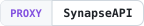
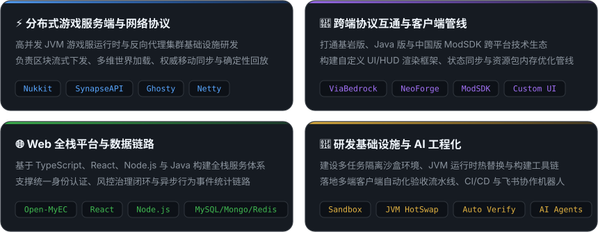
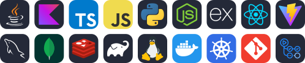

  <picture>
    <source media="(prefers-color-scheme: dark)" srcset="./assets/hero-dark.svg" />
    <source media="(prefers-color-scheme: light)" srcset="./assets/hero-light.svg" />
    
  </picture>

  <a href="https://github.com/EaseCation"><picture><source media="(prefers-color-scheme: dark)" srcset="./assets/pill-org-dark.svg" /></picture></a>
  <a href="https://github.com/EaseCation/Nukkit"><picture><source media="(prefers-color-scheme: dark)" srcset="./assets/pill-nukkit-dark.svg" /></picture></a>
  <a href="https://github.com/EaseCation/SynapseAPI"><picture><source media="(prefers-color-scheme: dark)" srcset="./assets/pill-synapse-dark.svg" /></picture></a>
  <a href="https://github.com/EaseCation/Ghosty"><picture><source media="(prefers-color-scheme: dark)" srcset="./assets/pill-ghosty-dark.svg" /></picture></a>
  <a href="https://github.com/EaseCation/easecation-open-myec"><picture><source media="(prefers-color-scheme: dark)" srcset="./assets/pill-myec-dark.svg" /></picture></a>

### ⚡ 核心研发领域

  <picture>
    <source media="(prefers-color-scheme: dark)" srcset="./assets/bento-dark.svg" />
    <source media="(prefers-color-scheme: light)" srcset="./assets/bento-light.svg" />
    
  </picture>

### 🛠️ 技术栈与工具链

  <picture>
    <source media="(prefers-color-scheme: dark)" srcset="./assets/skillicons-dark.svg" />
    <source media="(prefers-color-scheme: light)" srcset="./assets/skillicons-light.svg" />
    
  </picture>

  <code>Nukkit</code> · <code>Netty</code> · <code>Synapse / Nemisys</code> · <code>ViaBedrock / ViaProxy</code> · <code>NeoForge</code> · <code>Bedrock Add-ons &amp; ModSDK</code>

### 📊 Activity &amp; Contribution Graph

  <picture>
    <source media="(prefers-color-scheme: dark)" srcset="./profile-summary-card-output/github_dark/0-profile-details.svg" />
    <source media="(prefers-color-scheme: light)" srcset="./profile-summary-card-output/github/0-profile-details.svg" />
    
  </picture>

  <picture>
    <source media="(prefers-color-scheme: dark)" srcset="./profile-summary-card-output/github_dark/1-repos-per-language.svg" />
    <source media="(prefers-color-scheme: light)" srcset="./profile-summary-card-output/github/1-repos-per-language.svg" />
    
  </picture>
  <picture>
    <source media="(prefers-color-scheme: dark)" srcset="./profile-summary-card-output/github_dark/4-productive-time.svg" />
    <source media="(prefers-color-scheme: light)" srcset="./profile-summary-card-output/github/4-productive-time.svg" />
    
  </picture>

  <picture>
    <source media="(prefers-color-scheme: dark)" srcset="./assets/snake-dark.svg" />
    <source media="(prefers-color-scheme: light)" srcset="./assets/snake-light.svg" />
    
  </picture>

